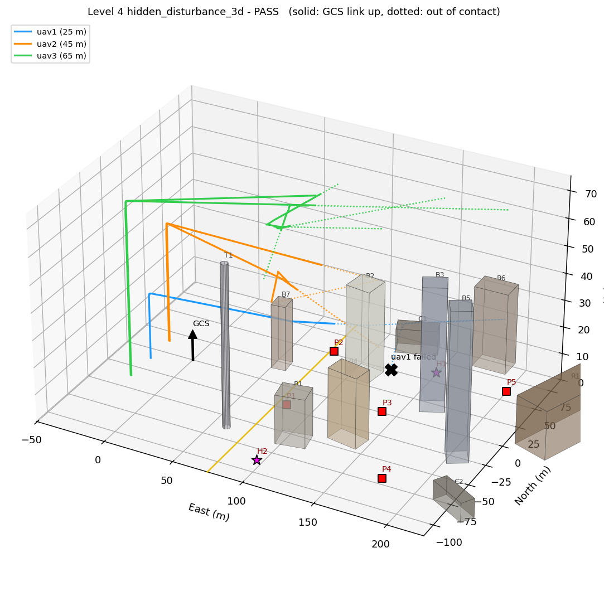

# UAV-X Stage 2 — Resilient BVLOS Swarm (Gazebo + ArduPilot + ROS 2)

A 3-D simulation of an autonomous UAV swarm surveying an earthquake-damaged town and
relaying its findings to a Ground Control Station over a resilient radio network, built on
**real ArduPilot firmware (SITL), Gazebo Harmonic physics, and ROS 2 Humble**.

PUSHPAK Grand Challenge 2026 · UAV-X: Resilient BVLOS Swarm Challenge · IIT Bombay Techfest.



*Three UAVs surveying the `quake_town` map. Solid lines are flight paths with a live GCS link,
dotted lines are flown out of radio contact; the black ✕ is a UAV lost to an injected motor
failure, red/magenta squares are the Points of Interest.*

## What this simulates

- **The drone** (`uavx_quad`): an ArduPilot quadcopter with IMU, GPS, barometer, magnetometer,
  a downward survey **camera** and a **rangefinder**, flown by real ArduPilot firmware over its
  ROS 2 (DDS) interface — exactly as a companion computer would on the real aircraft.
- **The 3-D world**: `quake_town`, an earthquake-damaged town — offices and housing up to 55 m,
  a 60 m telecom mast, collapsed blocks and a landslide ridge. One map file drives the Gazebo
  world, the UAVs' obstacle-avoiding path planning, and radio shadowing through buildings.
- **The swarm**: a GCS assigns Points of Interest; each UAV plans around obstacles at its own
  flight level, finds the target with its camera, geolocates it, and reports back over an
  emulated mesh radio (100 m range, store-and-forward when out of range).
- **Hidden disturbances** (the Stage 2 challenge): UAV failures, low battery, radio outages,
  packet loss, jamming and surprise emergency PoIs — drawn at random from a seed, invisible to
  the swarm until they strike.

An independent referee scores every run against the challenge metrics (mission completion,
communication, autonomy, safety) and draws the map above.

## Quick start

Full setup, prerequisites and per-level details: **[ros2/README.md](ros2/README.md)**.

```bash
# inside WSL Ubuntu 22.04, with the ArduPilot + Gazebo + ROS 2 workspace installed
cd ros2
bash setup_ws.sh                       # build once
bash run_level.sh demo3d               # 3-D mission with hidden disturbances
bash run_level.sh 4 --gui              # or an earlier level, with the Gazebo window
```

## The levels

The mission is built up one step at a time; each runs with `bash ros2/run_level.sh <name>` and
ends with a PASS/FAIL verdict from the referee. All pass on the development laptop:

| Level | What it adds |
|---|---|
| 0 | bench check — sensors, parameters, motors, arming |
| 1 | one UAV flies a waypoint circuit and lands |
| 2 | + camera: finds and geolocates ground targets |
| 3 | + companion computer: GCS tasking and reporting over the radio |
| 4 | two UAVs + communication, a UAV failure and task re-allocation |
| **demo3d** | **three UAVs in the 3-D town with hidden disturbances** |

## Stage 1

The fast Python proof-of-concept simulator from Stage 1 lives in a separate repository:
[UAV_SWARM_PROJECT_S1](https://github.com/Ananymous08072008/UAV_SWARM_PROJECT_S1). This
repository is the high-fidelity Gazebo counterpart for Stage 2.

## Licence

MIT — see [LICENSE](LICENSE).
