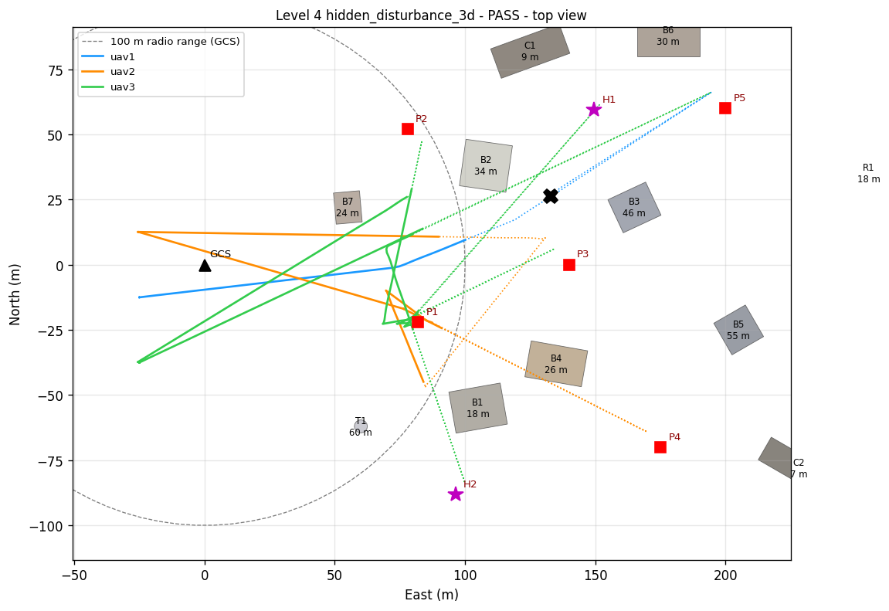

# UAV-X Stage 2: Gazebo + ArduPilot + ROS 2, level by level

This folder holds the high-fidelity stack for Stage 2, built up through the team's implementation plan:

```
LEVEL 0 bench hardware -> 1 one flying UAV -> 2 + camera -> 3 + companion computer
-> 4 two UAVs + communication -> 5 relay -> 6 multi-hop -> 7 imagery -> 8 failure recovery
-> 9 4-6 UAV swarm -> 10 disaster-response demonstration
```

Levels 0 to 4 are implemented and each one runs with a single command. Each run ends with a
PASS/FAIL verdict from an independent referee that uses Gazebo ground truth.
The fast Python simulator in the repository root stays the place for 100-seed sweeps. This stack
is the realistic check: real ArduPilot firmware, lock-step physics and sensors, and the same radio
model and mission constraints.

### Measured on this laptop (2026-10-13)

The machine: Ryzen 9 8940HX, RTX 5070 Ti, WSL 2 with 32 threads and 7.4 GiB RAM.

| Level | Verdict | Highlights | Sim / wall time |
|---|---|---|---|
| 0 bench | **PASS 19/19** | all sensors at rate; EKF and GPS within 0.74 m of truth; motor map 1->1, 2->4, 3->2, 4->3 (quad X) | 87 s wall |
| 1 one UAV | **PASS 6/6** | 4/4 waypoints, landing 0.19 m off the pad centre, true max 5.10 m/s | 145 s / 238 s |
| 2 + camera | **PASS 9/9** | 3/3 PoIs found from 5-8 m-off reports; geolocation mean 0.57 m, max 0.69 m; 12 images | 172 s / 265 s |
| 3 + companion | **PASS 11/11** | in-range reports 3.8 s or less under 40 % loss; the 150 m PoI delivered by store-and-forward (30 s, 11 tries); a 38 s silence correctly read as *out of range*, not lost | 193 s / 291 s |
| 4 two UAVs | **PASS 15/15** | failure of E1's owner detected in 11.0 s, E1 re-allocated and ACKed 0.05 s later; the 6 s outage ridden through; live reports 0.06 s or less; separation 25 m or more | 223 s / 552 s |
| 3-D hidden disturbances (`demo3d`, seed 7) | **PASS 14/14** | 7/7 PoIs incl. 2 hidden emergencies; all 7 hidden disturbances handled; geolocation mean 0.72 m; 0 collisions, closest approach to a building 10.7 m; separation 25 m or more | 566 s sim |

Gazebo runs below real time with the cameras on: about 0.65x with one UAV, 0.41x with two,
about 0.25x with three. ArduPilot and Gazebo run in lock-step, so the results do not depend on
that; a run just takes longer on the wall clock (`demo3d` takes about 40 minutes). The organisers'
re-run machine (16 cores, 128 GB, Ubuntu) is faster.

> **Don't attach the Gazebo window to a 3-UAV run that is already going.** On this laptop it
> dropped `demo3d` from about 0.25x to 0.05x real time for the rest of the run, about 2 hours
> instead of 40 minutes. Use `--gui` from the start, and only for one- or two-UAV levels. For
> `demo3d`, look at `map3d.png` and `images/` afterwards.

## What is simulated

| Part | Implementation |
|---|---|
| Autopilot | ArduPilot Copter (master) SITL, one instance per UAV, JSON lock-step with Gazebo |
| Physics and sensors | Gazebo Harmonic (gz-sim 8), world `uavx_disaster`: GCS + 10 m mast at the origin, 6 pads, the 1000 m x 1000 m operational area (x 75..1075, y -500..500), rubble |
| Drone `uavx_quad` | Iris airframe with IMU (1 kHz), GPS, barometer, magnetometer, **nadir camera** 640x480 at 5 Hz (69 deg FOV: 41 m x 31 m of ground from 30 m), **downward rangefinder** (0.02 to 120 m, 10 Hz) and a colour ID beacon |
| Fake sensors in ROS 2 | **mesh radio** (`radio_net`), **20-minute battery** (on the companion), PoI field reports (`scenario_manager`) |
| Autopilot link | ArduPilot's native ROS 2 interface (XRCE-DDS, one micro-ROS agent): `/ap/v<SYSID>/...` topics and services; GUIDED-mode position goals |
| Mission constraints | 5 m/s (`WP_SPD`), 100 m ceiling + 1.6 km fence (ArduPilot); 20 min endurance, 20 m separation, 10 s report deadline (companion / GCS / referee) |
| Radio model | Same equations and numbers as the Python simulator (`config/parameters.yaml` `communication:`): log-distance path loss, logistic PDR, 85 % PDR at 100 m and nothing beyond, plus injected outage, packet loss and jamming |

```
             Gazebo Harmonic (lock-step physics, sensors, uavx_disaster world)
               |  JSON (UDP 9002+10i)            |  ros_gz_bridge (camera, rangefinder,
               v                                 v  GPS, baro, mag, ground truth)
 ArduPilot SITL uavN --XRCE-DDS--> micro-ROS agent --> /ap/vN/*  <---- companion (uavN) ---- poi_detector (uavN)
   (MAVProxy UDP 14550+10i)                                              |  /radio/tx  ^ /uavN/radio/rx
                                                                         v            |
  scenario_manager --/scenario/poi--> gcs <--/gcs/radio/rx-- radio_net (channel model on ground truth)
     (PoIs, disturbances, inject)                                       ^
  mission_monitor (referee): ground truth + all events -> events.jsonl, timeseries.csv, summary.json
```

## Prerequisites

The stack runs inside **WSL 2, Ubuntu 22.04** (the distro `Ubuntu-22.04`, not the WSL default
`docker-desktop`), or on native Ubuntu 22.04:

- ROS 2 Humble (`/opt/ros/humble`) and Gazebo Harmonic
- the ArduPilot ROS 2 workspace `~/ardu_ws` (ardupilot, ardupilot_gz, ardupilot_gazebo, ros_gz,
  micro_ros_agent), with `~/ardu_ws/env.sh` sourced from `~/.bashrc`
- Python: numpy, OpenCV (`cv2`), PyYAML, pymavlink, MAVProxy

## Build (once, and again after changing messages or CMake packages)

From Windows PowerShell:

```bash
wsl -d Ubuntu-22.04
```

Then, inside Ubuntu:

```bash
bash /mnt/c/Users/ASUS/Pictures/Screenshots/TechFest/UAV_SWARM_PROJECT_S2/ros2/setup_ws.sh
```

This creates `~/uavx_ws`, links `src/` to this folder and builds `uavx_interfaces`, `uavx_gazebo` and
`uavx_swarm` with `--symlink-install`. Python, YAML and launch edits made in the repository then
apply without a rebuild. A new scenario file still needs one rebuild, so it gets installed.

## Run a level

```bash
bash ros2/run_level.sh 0
```

`run_level.sh 0` to `run_level.sh 4` run Levels 0 to 4, and `run_level.sh demo3d` runs the 3-D
mission with hidden disturbances. Add `--gui` to watch in the Gazebo window, for example
`bash ros2/run_level.sh 4 --gui`. Add `--seed N` to fix the random draws (hidden disturbances,
radio fading) so a run can be replayed exactly.

Every run gets a fresh directory, `~/uavx_runs/level<N>_<date>_<time>/`, so ArduPilot parameters
from one run never leak into the next. The terminal shows the level's own nodes. At the end you
get the referee's table and `summary.json`, and the script's exit code is 0 only on PASS.
The equivalent raw command is
`ros2 launch uavx_swarm uavx.launch.py scenario:=level4 gui:=true`.

### The levels

| Level | `run_level.sh` | What happens | What the referee checks |
|---|---|---|---|
| **0** Bench | `0` | uav1 powers up on pad 1, nothing flies. `bench_check` measures every sensor, reads back the ArduPilot parameters, waits for pre-arm, compares EKF/GPS with ground truth, runs a MAVLink motor test (each motor at 20 %) and arms/disarms over DDS | 19 checks: sensor rates, camera not blank, rangefinder reads the pad, baro/mag plausible, constraint parameters (`WP_SPD` 5, `FENCE_ALT_MAX` 100, ...), pre-arm, frame alignment within 1.5 m, motor-to-output map, arming |
| **1** One flying UAV | `1` | The companion flies an on-board plan: take off to 30 m, four waypoints at 25-40 m, back to the pad, land | all waypoints, landing error 2 m or less, true speed 5.5 m/s or less, height 100 m or less, no geofence breach |
| **2** + camera | `2` | Three red PoI targets, each with a reported position 5 to 8 m off. The UAV flies to each one, the nadir camera finds the real target, `poi_detector` geolocates it and saves imagery | all 3 found, geolocation error 2.5 m or less (against the true target), imagery saved |
| **3** + companion computer | `3` | The GCS assigns the PoIs over the emulated radio. The companion reports each find (ACKed, retransmitted) under 40 % injected packet loss. P3 appears at t = 20 s, 150 m out (beyond range): surveyed out of contact, carried back, delivered | every report reaches the GCS, in-range reports within 10 s of detection, the out-of-range one delivered by store-and-forward, status PDR 0.5 or more |
| **4** Two UAVs + communication | `4` | Two UAVs on the 25 m and 45 m layers share the PoIs. t = 35: 50 % loss on uav2. t = 75: 6 s outage on uav2. t = 90: emergency PoI E1. t = 100: uav2 motor failure. The GCS detects the loss and re-allocates uav2's PoIs to uav1 | every PoI surveyed incl. E1, re-allocation happened, failure detected within 15 s, the 6 s outage **not** taken for a failure, separation 20 m or more, no collision, uav1 lands |

Scenario files are plain YAML (`src/uavx_swarm/config/level*.yaml`). Copy one to make a new
level, for example with more UAVs, other PoIs or other disturbance times, and run it with
`bash ros2/run_level.sh path/to/my_level.yaml`.

### 3-D mission with hidden disturbances (`demo3d`)

```bash
bash ros2/run_level.sh demo3d
```

Add `--gui` to watch it, or `--seed 42` to replay a particular draw.

**The map.** `quake_town` (`src/uavx_gazebo/maps/quake_town.yaml`) is an earthquake-damaged town
east of the GCS: offices, a hospital and housing 18 to 55 m tall, two collapsed blocks, a 60 m
telecom mast and a landslide ridge. That one file is used by every part of the stack:

- **Gazebo:** the map becomes physics and visuals, so the camera and rangefinder see it.
- **Companions:** each one plans an A* path on a 4 m grid around every obstacle taller than its
  flight level minus 10 m. On the 25 m level the paths weave through town; at 65 m only the
  high-rise and the mast are in the way.
- **`radio_net`:** buildings on a radio path attenuate it by 20 dB per concrete building, so a
  low UAV behind a block loses its link.
- **GCS:** it uses the same map to predict links. A UAV hidden behind a building is not
  mistaken for a failure, and allocation prefers the UAV whose flight level keeps contact over
  the PoI.
- **Referee:** it checks obstacle collisions and the minimum clearance, and draws the run.

**The swarm.** Three UAVs fly the 25, 45 and 65 m levels (20 m vertical separation). There are
five announced PoIs, P4 and P5 appearing later.

**Hidden disturbances.** The scenario fixes only each disturbance's type, time window and value
range. When the mission clock starts, `scenario_manager` draws the concrete plan from the seed.
The seed is printed, and the plan goes to `hidden_plan.json` for the audit afterwards. No node
of the swarm reads that plan; the swarm meets each disturbance only when it fires:

| Hidden disturbance | Window | Drawn per run |
|---|---|---|
| UAV motor failure | 70-150 s | the busiest UAV at that moment |
| low battery (19-21 %) | 100-180 s | a random airborne UAV, which returns to recharge |
| radio outage 5-8 s | 40-160 s | a random airborne UAV |
| packet loss 20-40 % on all links, 20-40 s | 30-150 s | |
| jamming 20-30 dB, radius 30-50 m, 30-60 s | 40-160 s | near a PoI that is still pending |
| 2 emergency PoIs (priority 4-5) | 30-150 s | random free spots in the town |

At most two UAVs are taken out (failure or battery), so the mission stays feasible.

**Pass criteria.** Every announced and hidden PoI is found, surveyed and reported. Every report
made while in GCS contact arrives within 10 s. Every disturbance is handled (the referee builds the
report template's section 7 table: detection, response, recovery time). There is no collision
between UAVs or with the map, separation stays at least 20 m, and every UAV not hit by the
failure lands on its pad.

The run also leaves `map3d.png`, a 3-D view of the town with each flight path (solid while
linked to the GCS, dotted out of contact), the PoIs, the failure point and the jamming zone,
and `map2d.png`, a top view with the GCS's 100 m radio range.

**What happened with seed 7.** The draw:

| Mission t | Hidden disturbance |
|---|---|
| 37 s | emergency PoI H1 |
| 51 s | jamming |
| 87 s | emergency PoI H2 |
| 91 s | 27 % loss on every link |
| 96 s | motor failure of the busiest UAV (uav1, out of range at the time) |
| 104 s | 5 s outage on uav2 |
| 152 s | uav2 down to 19 % battery |

How the swarm handled it:

- The GCS put each emergency PoI at the head of a queue, 0.5 to 1 s after it appeared (3
  pre-emptions in all).
- uav1 failed out of range, so the GCS first assumed it was alive and buffering. It declared
  uav1 lost when it stayed silent past the 90 s out-of-range limit, then moved its four PoIs.
- uav2 went home on its low battery and released its three PoIs.
- uav3, held in reserve on its pad until then, took over and finished the last five alone.
- The GCS recalled the swarm at t = 467 s with all 7 PoIs done. Completion rate and
  priority-weighted score were both 1.0, and nothing hit a building.




**What this run shows still needs work**, all to be fixed by later levels:

- 5 of 7 reports were ferried (store-and-forward, 32 to 167 s late), because most of the town is
  beyond the 100 m range. Level 5 relays fix that.
- Detecting a failure out of range took 91 s. A watchdog based on when the UAV is expected back
  would cut it.

**Bring your own map.** Copy `quake_town.yaml`, change or add obstacles (`box` with
size/yaw/tilt, or `cylinder`), and point a scenario at it with `map: <name>`. Nothing else
changes.

## Inject a disturbance by hand

Open a second Ubuntu terminal while a level runs, then run, for example:

```bash
source ~/ardu_ws/env.sh && source ~/uavx_ws/install/setup.bash
```

```bash
ros2 run uavx_swarm inject packet_loss uav1 --loss 0.4 --duration 30
```

The available injections:

| Command | Effect |
|---|---|
| `inject comm_outage uav2 --duration 20` | the UAV's radio is dead for 20 s |
| `inject packet_loss '*' --loss 0.3 --duration 60` | 30 % extra frame loss on every link |
| `inject jamming --center 80 0 --radius 50 --attenuation 30 --duration 60` | jamming zone |
| `inject battery uav1 --pct 22` | low battery: return home and release its PoIs |
| `inject new_poi --id E9 --pos 70 10 --priority 5` | new emergency PoI |
| `inject uav_failure uav2` | motor failure: the motors stop and it falls |

Each one is logged as a `DISTURBANCE` event, exactly like the scheduled ones in a scenario file.

## What a run leaves behind

| File | Contents |
|---|---|
| `summary.json` | verdict, criteria, and the metrics named in the Stage 2 report template (section 10) |
| `events.jsonl` | every decision and disturbance, in sim time: state changes, assignments, reports, re-allocations, recoveries |
| `timeseries.csv` | 2 Hz per UAV: true position, speed, state, battery, GCS link, separation |
| `packets.csv` | every radio frame per receiver: delivered or why not (`no_link`, `lost`, `outage`), latency, PDR, distance |
| `images/` | survey snapshots from the nadir camera with the geolocated targets marked |
| `launch.log`, `0/`, `1/`, `mav.tlog` | full simulator output, per-instance ArduPilot eeprom/logs, MAVLink log |

## Files

```
ros2/
  setup_ws.sh, run_level.sh
  src/uavx_interfaces/   RadioPacket, LinkState, NetworkState, PoiDetection
  src/uavx_gazebo/       models/uavx_quad, models/poi_marker, worlds/uavx_disaster.sdf,
                         maps/quake_town.yaml (3-D map),
                         config/uavx_quad.parm (ArduPilot), config/uavx_quad_bridge.yaml
  src/uavx_swarm/        config/level0..4.yaml, demo3d.yaml, radio.yaml; launch/uavx.launch.py
    uavx_swarm/          common.py, ap_client.py (ArduPilot DDS), radio_model.py, radio_endpoint.py (ARQ),
                         world_map.py (3-D map: world generation, A* planner, radio shadowing)
    uavx_swarm/nodes/    bench_check, companion, poi_detector, radio_net, gcs,
                         scenario_manager, mission_monitor, inject
    test/                test_world_map.py (pytest, no simulator needed)
```

The map unit tests run in a few seconds:

```bash
cd ros2/src/uavx_swarm && python3 -m pytest -q test
```

## Next: Level 5, two UAVs + relay

**The gap that Level 4 leaves.** A PoI beyond the 100 m radio range (P3, 150 m out) is surveyed
blind. Its report waits in the companion's ARQ outbox until the UAV flies back into range: about
30 s in Level 3, three times the organisers' 10 s limit. Meanwhile the GCS has no live view of
that UAV. In Level 4 the other UAV is often within range of both of them (uav2 at P2 is 73 m
from uav1 at P3) but cannot forward. Level 5 turns that UAV into a relay.

**What to build.** Each piece reuses an algorithm that is already written and tested in the
Python simulator:

1. **Forwarding in the radio stack** (`radio_endpoint.py`, `RadioPacket.msg`). Add `final_dst`
   and `ttl` fields. `dst` becomes the link-level next hop, and a node re-sends a frame that is
   addressed through it towards `final_dst`. Duplicates are dropped by (src, seq).
   `radio_net` needs no change, because it already models single links.
2. **Routing**: ETX distance-vector, decentralised. The GCS advertises cost 0 in its heartbeat.
   Every UAV puts its best cost to the GCS and its next hop in its 1 Hz STATUS. A neighbour's
   ETX is 1 / (heartbeat delivery ratio over 5 s). Use the weak-link penalty and the 15 %
   hysteresis of `swarm/route_manager.py`. With 2 to 3 hops it converges in one or two
   heartbeats.
3. **Relay role**, decided at the GCS (`gcs.py`). When a PoI's predicted direct-link PDR is
   below 0.85, place relay points with `swarm/relay_selector.py` (`_straight`: hops at
   0.9 x the range for PDR 0.85). For P3 that is one relay near (75, -5) at the 45 m layer.
   Give the relay role to the idle UAV with the lowest cost, before the surveyor leaves
   coverage. The companion gets a `RELAY` state that flies to the point, holds there and
   forwards. It leaves when released or when its battery says so; in that case it hands over
   first, using the S2 energy manager's rules.
4. **Fallback**. With no relay available, or the relay lost, keep today's store-and-forward and
   return-to-comm behaviour. The GCS logs the role changes as `RELAY_ASSIGNED` and
   `RELAY_RELEASED`, which is the "relay reallocations" metric.

**Level 5 scenario** (`level5.yaml`). Level 3's PoIs plus a second UAV. Disturbances: a 15 s
outage on the relay while P3 is being surveyed (the surveyor falls back to buffering, then
recovers through the relay), and 30 % packet loss on the relay hop.

**Pass criteria.** P3's report reaches the GCS in 10 s or less, through the relay. The surveyor's
GCS connectivity is at least 0.95 while it is out of direct range. The recovery time after the
relay outage is measured. Separation stays at least 20 m, with the relay on the 45 m layer and the
surveyor at 25 m.

After that: **Level 6** extends the chain to three UAVs (a PoI 250 m out needs two relays,
`relay_selector` already plans chains). **Level 7** adds imagery traffic, the 3 Mbit/s camera
stream from `data:` in `config/parameters.yaml`, so link capacity matters. **Level 8** adds
relay failure and hand-over (`swarm/reconfiguration.py`, `energy_manager.py`).
